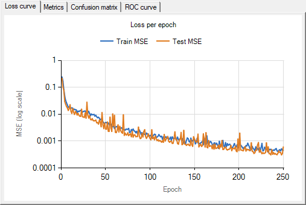
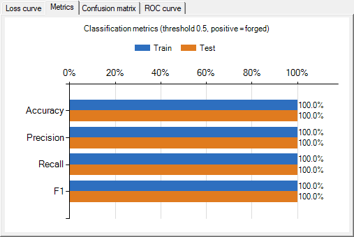
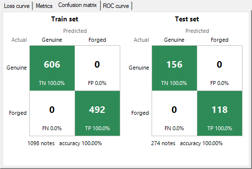
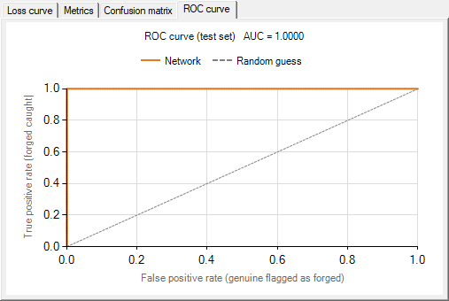

# Banknote Authentication C#

Binary classification (genuine vs. forged banknote) using our own 3-layer neural network
(`NeuralNet`, `INeuron`, `HNeuron`, `ONeuron`: sigmoid activations, backpropagation).
No machine-learning libraries are used. The only extra .NET library is the built-in
`System.Windows.Forms.DataVisualization` Chart control, used purely to draw the graphs.

## How to run
Requirements: Windows, Visual Studio with the **.NET desktop development** workload (.NET Framework 4.8, WinForms).

1. Open `neural.slnx` in Visual Studio and press **F5**.
2. Click **Load Dataset** and choose `neural/Data/data_banknote_authentication.csv`.
3. Set **hidden neurons / learning rate / epochs** in the boxes at the top left (default `4 / 0.5 / 250`, the tuned configuration).
4. **Create NN**: loads the CSV, splits it 80/20, MinMax-scales it and creates a new 4 → hidden → 1 network.
5. **Train NN**: trains for the given number of epochs. It then:
   - prints the train and test loss at the first epoch, every 100 epochs and the last epoch,
   - prints the confusion matrix, Accuracy, Precision, Recall, F1 and MSE for both the train and test sets,
   - saves `training_log.csv` (train and test MSE for every epoch) next to `neural.exe`,
   - fills in the graphs (see [Visualizations](#visualizations)).

   Pressing it again continues training the same network.
6. **Run NN**: type the 4 feature values of a banknote and get the network's output (≥ 0.5 = forged).
7. **Tune Hyperparameters** (optional): trains one fresh network per combination in a grid, prints a table
   and saves `tuning_results.csv` next to `neural.exe`. It does not change the network made with Create NN.

## Files
| File | Purpose |
|---|---|
| `neural/BackNeural 1.cs`, `neural/InputN 1.cs`, `neural/HiddenN 1.cs`, `neural/OuputN 1.cs` | Neural network engine (from the previous activity) |
| `neural/Banknote.cs` | CSV loading, train/test split, MinMax scaling, training loop, metrics (confusion matrix, accuracy, precision, recall, F1, MSE, ROC/AUC) |
| `neural/Form1.cs` | Buttons: Load Dataset, Create / Train / Run NN, Tune Hyperparameters |
| `neural/Form1.Charts.cs` | The evaluation graphs (loss curve, metrics, confusion matrix, ROC curve) |
| `neural/Data/data_banknote_authentication.csv` | Dataset |
| `Results/training_log.csv` | Exported training log of the chosen configuration (train and test MSE for every epoch) |
| `Results/tuning_results.csv` | Exported results of the hyperparameter grid |
| `docs/*.png` | Screenshots of the graphs used in this README |

Only change to the engine: the learning rates were `const` (0.2 for the hidden → output weights, 0.15 for the input → hidden weights).
They are now `readonly` fields, and a constructor `NeuralNet(input, hidden, output, lrOutput, lrInput)` was added
so they can be tuned. This program passes the same value for both. The original constructors still use 0.2 / 0.15.

## Data description
**Banknote Authentication** dataset from the UCI Machine Learning Repository
(https://archive.ics.uci.edu/dataset/267/banknote+authentication), donated in 2012 by
Volker Lohweg and Helene Dörksen (Ostwestfalen-Lippe University of Applied Sciences, Germany).

Genuine and forged banknote-like specimens were photographed with an industrial print-inspection camera
(400×400 px, grayscale, about 660 dpi). A wavelet transform was applied to each image and 4 texture features were extracted:

| Feature | Meaning |
|---|---|
| variance | variance of the wavelet-transformed image |
| skewness | skewness of the wavelet-transformed image |
| curtosis | kurtosis of the wavelet-transformed image |
| entropy | entropy of the image |
| class (label) | 0 = genuine, 1 = forged |

1,372 rows (762 genuine = 56%, 610 forged = 44%), no missing values. The classes are close to balanced,
so accuracy is a meaningful metric. The CSV is sorted by class (all 0s first), which is why it must be shuffled before splitting.
The UCI page does not say which class number means "genuine". 0 = genuine is the common convention and is used here.

## Preprocessing
- **Parsing:** the CSV is read with `CultureInfo.InvariantCulture` (`.` as decimal point on any PC).
  Lines without exactly 5 columns (e.g. blank lines) and lines that are not fully numeric (e.g. the header) are skipped.
- **Split:** the rows are shuffled with a fixed seed (42), so the split is the same every run, then split
  **80% train (1,098 rows) / 20% test (274 rows)**.
- **MinMax scaling** to [0, 1]: `x' = (x − min) / (max − min)`. The min and max come from the **training set only**,
  so no information from the test set leaks into training. The same min/max are reused to scale the values typed into Run NN.

## Training log (4 hidden, lr 0.5, 250 epochs)
```
Epoch     1   train MSE = 0.245758   test MSE = 0.218301
Epoch   100   train MSE = 0.001577   test MSE = 0.001257
Epoch   200   train MSE = 0.000669   test MSE = 0.000441
Epoch   250   train MSE = 0.000456   test MSE = 0.000610
```
The full per-epoch log of this run is in `Results/training_log.csv`.
- **Train MSE** is averaged over each epoch while the weights are updating.
- **Test MSE** is measured after each epoch with the weights frozen.

The loss drops by about 500× over training. The test MSE jumps up and down slightly between epochs
(e.g. 0.00044 at epoch 200 vs 0.00061 at epoch 250), because the weights are updated after every single sample,
but its overall trend keeps falling.

Initial weights are random, so the exact numbers change slightly each run.
In 5 repeated runs of this configuration, test accuracy, precision and recall were 100% every time,
and test MSE was between 0.00065 and 0.00081.

## Hyperparameter tuning
Grid: hidden neurons {2, 4, 8} × learning rate {0.01, 0.2, 0.5} × epochs {100, 250} = 18 runs
(set at the top of `btnTuneBanknote_Click` in `Form1.cs`).
Each run trains a new network on the training set and is scored on the test set.
Full results: `Results/tuning_results.csv`.

**Test accuracy:**

| hidden \ lr, epochs | 0.01, 100 | 0.01, 250 | 0.2, 100 | 0.2, 250 | 0.5, 100 | 0.5, 250 |
|---|---|---|---|---|---|---|
| 2 | 91.97% | 98.18% | 98.91% | 97.45% | 100% | 100% |
| 4 | 93.07% | 98.18% | 98.91% | 100%   | 100% | 100% |
| 8 | 94.53% | 98.18% | 98.91% | 100%   | 100% | 100% |

**Test MSE** (lower is better; this separates the configurations that all reach 100%):

| hidden \ lr, epochs | 0.01, 100 | 0.01, 250 | 0.2, 100 | 0.2, 250 | 0.5, 100 | 0.5, 250 |
|---|---|---|---|---|---|---|
| 2 | 0.0885 | 0.0206 | 0.0076 | 0.0167 | 0.0016 | 0.00074 |
| 4 | 0.0796 | 0.0189 | 0.0072 | 0.0027 | 0.0015 | **0.00056** |
| 8 | 0.0559 | 0.0190 | 0.0066 | 0.0021 | 0.0012 | 0.00080 |

**Findings:**
- **Learning rate mattered most.** At 0.01 the network learns too slowly: 92–95% after 100 epochs and still only
  98.2% after 250. At 0.2 it needs 250 epochs to reach 100% (for 4 and 8 hidden neurons). At 0.5 every network
  size reaches 100% within 100 epochs.
- **Epochs:** more epochs lower the MSE in almost every case (the network becomes more confident).
  At lr 0.5 the accuracy is already 100% after 100 epochs, so the extra 150 epochs mainly reduce the MSE (by about 1.5–3×).
- **Hidden neurons:** 2 neurons is the least stable. At lr 0.2 its accuracy *dropped* from 98.91% (100 epochs)
  to 97.45% (250 epochs) while 4 and 8 neurons improved to 100%. 4 and 8 neurons behave almost the same.
- **Chosen configuration: 4 hidden neurons, learning rate 0.5, 250 epochs.** It reaches 100% test accuracy with the
  lowest test MSE in the grid (0.00056), and was stable across 5 repeated runs. 4 and 8 neurons score almost the same,
  so the smaller network was preferred.
- **Not tested:** learning rates above 0.5 and more than 250 epochs. Since MSE was still falling at 250 epochs,
  longer training could make the network even more confident, but it cannot improve the accuracy further.

## Evaluation
Positive class = **forged** (1); threshold 0.5.

| Metric | Meaning here |
|---|---|
| Accuracy | share of all notes classified correctly |
| Precision | of the notes flagged as forged, how many really were forged |
| Recall | of the forged notes, how many were caught |
| F1 | harmonic mean of precision and recall |
| MSE | average squared difference between the output (0–1) and the label; shows how *confident* the predictions are |
| ROC AUC | how well the output separates the two classes across every possible threshold (1.0 = perfect, 0.5 = random guessing) |

**Chosen model (4 / 0.5 / 250):**
```
TRAIN (1,098 notes)                    TEST (274 notes, never seen in training)
              genuine  forged                        genuine  forged
  genuine        606       0             genuine        156       0
  forged           0     492             forged           0     118
Accuracy 100%  Precision 100%            Accuracy 100%  Precision 100%
Recall   100%  F1        100%            Recall   100%  F1        100%
MSE 0.00064                              MSE 0.00061    ROC AUC 1.0000
```

**Analysis:**
- **Recall is the most important metric for this problem.** A missed forgery (false negative) is the costly mistake,
  because a fake note gets accepted. The model missed none.
- **For comparison, an under-trained model** (2 hidden, lr 0.01, 100 epochs; 5 runs) still gets 91–94% accuracy and
  95–96% precision, but only **84–90% recall**: it lets 12–19 of the 118 forged test notes through.
  This is why accuracy alone is not enough.
- **No overfitting:** train and test results are both 100% with almost the same MSE (0.00064 vs 0.00061),
  and the test loss curve falls together with the train loss curve.
- **Why a small network is enough:** the dataset is nearly linearly separable, so even 2–4 hidden neurons can
  classify it perfectly once the learning rate is high enough.
- **Caveat:** the configuration was chosen using the test set, which makes the test score slightly optimistic.
  A stricter setup would tune on a separate validation split and use the test set only once at the end.

## Visualizations
After **Train NN**, the tabs under the Create/Train panel show (screenshots of the chosen 4 / 0.5 / 250 model):

| Loss curve | Metrics |
|---|---|
|  |  |
| Train and test MSE per epoch (log scale). Both fall together, so no overfitting. | Accuracy / Precision / Recall / F1 for train vs test. |

| Confusion matrix | ROC curve |
|---|---|
|  |  |
| Green = correct, red = mistakes, darker = more notes. | Test set. The curve hugs the top-left corner (AUC 1.0); the dashed line is random guessing. |
